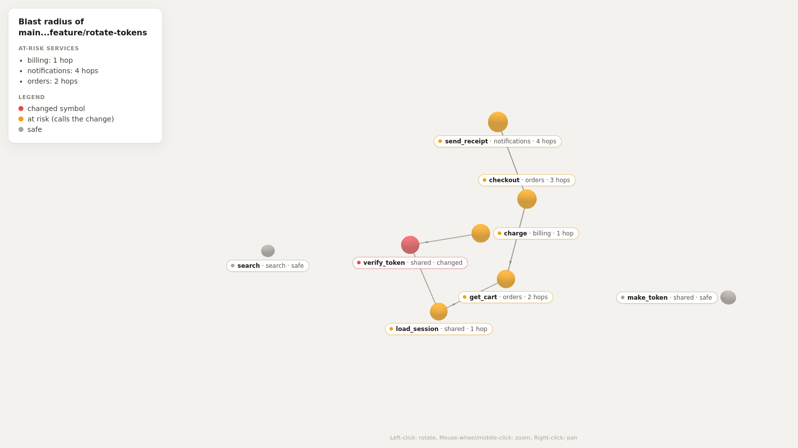

# What breaks if I change verify_token?

You open a pull request that touches `shared/auth.py`. It is a small change: `verify_token` now splits the token and checks a key id instead of a prefix, so tokens can be rotated later. The diff is three lines and the signature does not change. Review looks fine.

The question nobody can answer from the diff is who calls `verify_token`, and who calls them. In a monorepo the answer is usually "more than you think", and you find out from a red build in a service you did not touch, or from production.

I built a small Cognee community connector, Cognee GitGraph, to answer that question before the merge. It reads a git repository, parses the Python code into symbols and call references, reads CI test results from JUnit XML, and loads all of it into Cognee's graph memory. From the same rows it computes the blast radius of a branch: which functions can reach the code you changed, how many hops away, which services they live in, and which CI failures belong to those services. It makes no LLM calls and needs no API key.

## The demo

The package ships a sample repo so you can see the whole thing in one command. It is a tiny shop: a `shared` package with auth and sessions, plus `billing`, `orders`, `notifications` and `search` services. The branch `feature/rotate-tokens` changes `verify_token`. Here is the real output of `bun run demo`:

```text
Blast radius of main...feature/rotate-tokens (up to 4 hops)
Changed files (1): shared/auth.py
Changed symbols (2): shared/auth.py::make_token, shared/auth.py::verify_token

At-risk services:
  billing  1 hop  shared/auth.py::verify_token -> billing/invoice.py::charge
  notifications  4 hops  shared/auth.py::verify_token -> shared/session.py::load_session -> orders/cart.py::get_cart -> orders/checkout.py::checkout -> notifications/receipts.py::send_receipt
  orders  2 hops  shared/auth.py::verify_token -> shared/session.py::load_session -> orders/cart.py::get_cart
At-risk symbols: 5 in 5 files

Co-changed files:
  billing/invoice.py  (1 shared commit)
  shared/__init__.py  (1 shared commit)

CI failures in at-risk services:
  billing-tests  billing  billing.test_invoice::test_charge_with_max_age  TypeError: charge() got an unexpected keyword argument 'max_age'
  orders-tests  orders  orders.test_checkout::test_checkout_rejects_bad_token  assert False is True

Cognee graph (dataset gitgraph-b73e5edafa07):
  ci_failures: 2
  commits: 8
  file_changes: 15
  references: 10
  symbols: 8
Links between rows:
  ambiguous: 0
  from_symbol_references_symbols: 5
  missing: 0
  sha_references_commits: 15
  to_symbol_references_symbols: 10
```

Reading it top to bottom:

- **billing is 1 hop away.** `charge` in `billing/invoice.py` calls `verify_token` directly. That is the one a reviewer might spot.
- **orders is 2 hops away.** `get_cart` calls `load_session`, which calls `verify_token`. The middle step lives in `shared`, the same service as the change, so it does not count as a service of its own, but it is still on the path.
- **notifications is 4 hops away.** `send_receipt` calls `checkout`, which calls `get_cart`, and so on down to `verify_token`. Nobody reviewing an auth change opens the receipts code. The report prints the whole chain, so you can check it yourself instead of trusting a score.
- **search is safe.** Nothing in it imports or calls the auth code, so it is not in the list.

Two more sections help with triage. "Co-changed files" lists files that shared a past commit with `shared/auth.py`; `billing/invoice.py` changed with it when token expiry was added. "CI failures in at-risk services" keeps only the failing tests whose service is at risk, so each failure sits next to the call chain that explains it.

Both changed symbols are listed because the CLI takes the changed file names from `git diff base...head`, and every symbol in a changed file counts as changed. `make_token` has no callers, so it adds nothing.



`cognee-gitgraph demo --html blast.html` writes the same result as a single self-contained page with a 3D graph: red for the changed symbols, amber for the ones at risk, grey for the safe ones.

## How the rows get into Cognee

The connector is a dlt source, `gitgraph_source(repo_path, refs=None, ci_logs=None)`. It reads everything up front with GitPython, Python's `ast` module and the standard XML parser, and yields five tables: `commits`, `file_changes`, `symbols`, `references` and `ci_failures`. Every table has a single `id` primary key and uses dlt's `replace` write disposition, so syncing the same repo twice adds no new row nodes.

You hand the source straight to Cognee:

```python
result = await cognee.remember(source, dataset_name="gitgraph", self_improvement=False)
print(await link_rows(source))
```

Cognee loads a dlt source through its relational-manifest path: each row becomes a node in the graph, linked to a node for its table. No LLM reads the rows and nothing is extracted from free text, so the same repo gives the same graph every time. Cognee still runs its local embedding model and its local GLiNER step, which need no key but download their models on the first run.

There is one gap. Cognee draws row-to-row edges only from foreign keys in the staging database, and dlt's SQL destination creates none, so a fresh load has rows connected to their tables and to nothing else. `link_rows` fills that in. It reads the graph, finds each row node through its edge to the table node, and writes edges named the way Cognee names its own foreign-key edges: `sha_references_commits` from a file change to its commit, `from_symbol_references_symbols` and `to_symbol_references_symbols` from a call reference to the two functions it connects, and `commit_sha_references_commits` from a CI failure to its commit. Running it again writes nothing new. An edge whose row node it cannot find, or finds more than once, is skipped and counted as `missing` or `ambiguous` instead of being guessed at.

To be precise about what does what: the blast radius is computed over the extracted rows, with a plain breadth-first walk over a NetworkX graph of callers. It is a pure function and does not need Cognee at all. With `--remember` (the demo always does this) the CLI also loads those rows into a Cognee dataset named `gitgraph-<first 12 characters of the head sha>`, which is the `gitgraph-b73e5edafa07` you see above. The sample repo uses a fixed author and date for every commit, so that name is the same on every machine.

## Proving it makes no LLM calls

"No LLM" is easy to claim and easy to break by accident, since Cognee can reach a model from several places. So there is an acceptance test for it, `tests/test_demo_acceptance.py`. It starts the CLI in a fresh Python process with every API key variable removed from the environment. Before the demo runs, it replaces Cognee's `LLMGateway` entry points and litellm's `completion` and `acompletion` with spies that record the call and then raise. It runs the demo twice, as text and as JSON, and asserts that both exit cleanly with zero recorded calls. A separate test makes one deliberate gateway call to show the spy does notice.

## Try it

From a checkout:

```bash
bun run setup
bun run demo
```

As a package, pointed at your own repo:

```bash
pip install "git+https://github.com/chrisbuildsonline/cognee-gitgraph"
cognee-gitgraph blast --repo . --base main --head my-branch --ci path/to/junit
```

Or with Docker and the network switched off, since the image bakes the local models in at build time:

```bash
docker build -t cognee-gitgraph .
docker run --rm --network none cognee-gitgraph bun run demo
```

The limits: only Python files are parsed, calls are resolved by name through imports (dynamic calls are not seen), and nested functions are skipped. For a shared helper in a Python monorepo, that is usually enough to know which teams to ping before you merge.

The code is at <https://github.com/chrisbuildsonline/cognee-gitgraph>, and the proposal to add it to cognee-community is <https://github.com/topoteretes/cognee/issues/6329>.
